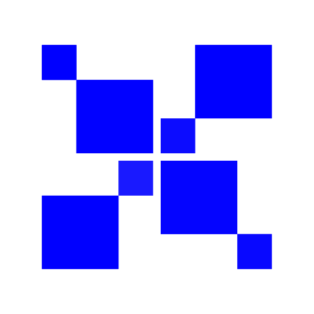

  

    

  
  
  

---

### ⚡ Tentang ChanThecno

**ChanThecno** merupakan platform teknologi independen yang berfokus pada pengembangan **kecerdasan buatan (AI)**, **otomatisasi**, dan **inovasi digital** untuk menghadirkan solusi yang bermanfaat bagi individu dan masyarakat.

> 🚀 **Status Pengembangan:** Saat ini sedang aktif dikembangkan secara independen oleh [**Candri Panjaitan**](https://github.com/candripanjaitan16) *(Founder & Lead Developer)*.

---

### 🛠️ Teknologi & Arsitektur

<table>
  <tr>
    <td width="180"><strong>AI & Backend</strong></td>
    <td>
      
      
      
      
    </td>
  </tr>
  <tr>
    <td><strong>Frontend & Web</strong></td>
    <td>
      
      
    </td>
  </tr>
  <tr>
    <td><strong>Infrastruktur</strong></td>
    <td>
      
      
      
      
    </td>
  </tr>
</table>

---

  📍 Indonesia • Sedang dikembangkan oleh <a href="https://github.com/candripanjaitan16">Candri Panjaitan</a>

